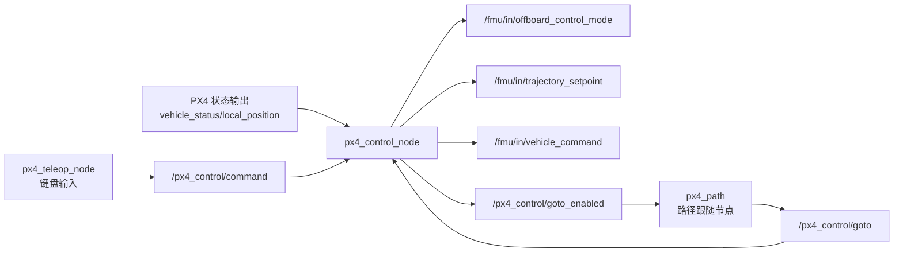

# px4_control 交付使用说明

## 1. 功能定位

`px4_control` 是 PX4 Offboard 控制入口包，负责把人工键盘命令和外部路径目标转换成 PX4 可执行的控制消息。

本包负责：

- 向 PX4 持续发布 Offboard 心跳：`/fmu/in/offboard_control_mode`
- 向 PX4 发布位置、速度、加速度、航向设定值：`/fmu/in/trajectory_setpoint`
- 向 PX4 发布模式切换、解锁、上锁、降落等命令：`/fmu/in/vehicle_command`
- 接收键盘控制命令：`/px4_control/command`
- 接收外部路径跟随目标：`/px4_control/goto`
- 发布外部 Goto 是否允许执行：`/px4_control/goto_enabled`

本包不负责路径录制、路径文件读取、路径平滑或轨迹生成。这些功能由 `px4_path` 完成。两包之间的依赖方向是：

```text
px4_path 生成 /px4_control/goto
px4_control 接收 /px4_control/goto 并下发 PX4 TrajectorySetpoint
```

## 2. 节点组成

| 节点 | 可执行文件 | 作用 |
|---|---|---|
| 控制节点 | `px4_control_node` | 维护飞行状态机，接收键盘命令和外部 Goto，向 PX4 下发 Offboard 心跳、轨迹设定值和 VehicleCommand |
| 键盘节点 | `px4_teleop_node` | 读取终端键盘，发布 `px4_control/msg/ControlCommand` 到 `/px4_control/command` |

## 3. 启动方式

### 3.1 启动控制节点

终端 1：

```bash
source install/setup.bash
ros2 launch px4_control px4_control.launch.py
```

等价地，也可以启动内部 bringup launch：

```bash
ros2 launch px4_control px4_bringup.launch.py
```

### 3.2 指定参数文件

```bash
ros2 launch px4_control px4_control.launch.py \
  params_file:=/path/to/px4_control/config/params.yaml
```

### 3.3 切换降落方式

`land_control` 可以在 launch 命令中覆盖：

```bash
# 使用本节点自主管理下降
ros2 launch px4_control px4_control.launch.py land_control:=false

# 使用 PX4 NAV_LAND 降落模式
ros2 launch px4_control px4_control.launch.py land_control:=true
```

### 3.4 启动键盘节点

键盘节点必须运行在真实终端中，才能读取按键：

```bash
source install/setup.bash
ros2 launch px4_control px4_teleop.launch.py
```

也可以直接运行：

```bash
ros2 run px4_control px4_teleop_node --ros-args \
  --params-file install/px4_control/share/px4_control/config/params.yaml
```

## 4. 基本操作流程

典型飞行流程：

```text
1. 启动 PX4、MAVROS/px4_ros_com、定位节点等外部基础节点
2. 启动 px4_control_node
3. 启动 px4_teleop_node
4. 按 0：请求进入 Offboard
5. 按 1：解锁并自动起飞到 takeoff_height
6. 飞机进入 HOVER 后，可用 WASDQE/LR 微调悬停目标
7. 如果要让 px4_path 接管路径跟随，按 4 打开外部 Goto 许可
8. 路径完成或需要人工接管时，按 5 关闭 Goto 并保持当前位置
9. 按 3 降落
10. 落地后按 2 上锁，或等待 PX4 自动上锁
```

## 5. 键盘说明

| 按键 | 功能 | 说明 |
|---|---|---|
| `0` | 请求 Offboard | 发送 PX4 `DO_SET_MODE`，切换到 Offboard |
| `1` | 解锁并起飞 | 进入 `ARMING`，目标高度为 `takeoff_height` |
| `2` | 上锁 | 仅在判断已落地时执行；空中会拒绝 |
| `3` | 降落 | 根据 `land_control` 选择 PX4 NAV_LAND 或自主管理下降 |
| `4` | 允许外部 Goto | 打开 `/px4_control/goto_enabled`，允许 `px4_path` 发布的目标生效 |
| `5` | 禁止外部 Goto | 关闭 Goto，并把当前位置固化为悬停目标 |
| `W` / `S` | X 方向移动 | NED 坐标系下 X 正/负，步长为 `step_xy` |
| `A` / `D` | Y 方向移动 | NED 坐标系下 Y 负/正，步长为 `step_xy` |
| `Q` / `E` | 上升/下降 | NED 坐标系下上升为 Z 负，下降为 Z 正，步长为 `step_z` |
| `L` / `R` | 调整 yaw | 每次变化 `yaw_step_rad` |

注意：当外部 Goto 已允许时，`W/S/A/D/Q/E/L/R` 会被控制节点忽略，防止人工微调和路径跟随同时改目标。

## 6. ROS 接口

### 6.1 订阅话题

| 话题 | 类型 | 来源 | 用途 |
|---|---|---|---|
| `/fmu/out/vehicle_local_position` | `px4_msgs/msg/VehicleLocalPosition` | PX4 | 获取当前位置、速度、航向和位置有效标志 |
| `/fmu/out/vehicle_status` | `px4_msgs/msg/VehicleStatus` | PX4 | 判断 Offboard、解锁、落地/上锁状态 |
| `/px4_control/command` | `px4_control/msg/ControlCommand` | `px4_teleop_node` | 接收键盘命令 |
| `/px4_control/goto` | `px4_control/msg/GotoTarget` | `px4_path` 或其他外部节点 | 接收路径跟随目标 |

### 6.2 发布话题

| 话题 | 类型 | 去向 | 用途 |
|---|---|---|---|
| `/fmu/in/offboard_control_mode` | `px4_msgs/msg/OffboardControlMode` | PX4 | Offboard 心跳，位置控制模式 |
| `/fmu/in/trajectory_setpoint` | `px4_msgs/msg/TrajectorySetpoint` | PX4 | PX4 位置/速度/加速度/yaw 设定值 |
| `/fmu/in/vehicle_command` | `px4_msgs/msg/VehicleCommand` | PX4 | Offboard、解锁、上锁、降落命令 |
| `/px4_control/goto_enabled` | `std_msgs/msg/Bool` | `px4_path` | 外部 Goto 许可状态，QoS 为 reliable + transient local |

## 7. 消息说明

### 7.1 ControlCommand

`ControlCommand` 是键盘节点发给控制节点的命令消息：

```text
uint8 cmd
float32 dx
float32 dy
float32 dz
```

`cmd` 取值：

| 常量 | 数值 | 功能 |
|---|---:|---|
| `CMD_OFFBOARD` | 1 | 请求进入 Offboard |
| `CMD_ARM` | 2 | 解锁并起飞 |
| `CMD_DISARM` | 3 | 上锁 |
| `CMD_LAND` | 4 | 降落 |
| `CMD_MOVE` | 5 | 位置增量控制，使用 `dx/dy/dz` |
| `CMD_YAW` | 6 | yaw 增量控制，`dx` 表示 yaw 变化量 |
| `CMD_GOTO_ENABLE` | 7 | 允许外部 Goto |
| `CMD_GOTO_DISABLE` | 8 | 禁止外部 Goto 并悬停 |

### 7.2 GotoTarget

`GotoTarget` 是外部路径模块发给控制节点的位置参考：

```text
bool active
float32 x y z
float32 vx vy vz
float32 ax ay az
float32 yaw
float32 yawspeed
```

含义：

- `active=true`：表示当前消息是有效目标。位置、速度、加速度、yaw、yawspeed 必须全部是有限值。
- `active=false`：表示立即停止外部 Goto。控制节点会关闭 Goto 许可，并保持当前位置。
- `x/y/z`：PX4 NED 坐标系下的位置目标，单位 m。
- `vx/vy/vz`：速度前馈，单位 m/s。waypoint 跟随中为 0，trajectory 跟随中由轨迹生成器计算。
- `ax/ay/az`：加速度前馈，单位 m/s²。waypoint 跟随中为 0，trajectory 跟随中由轨迹生成器计算。
- `yaw`：PX4 NED 航向角，单位 rad。
- `yawspeed`：航向角速度前馈，单位 rad/s。

## 8. 参数说明与调参

参数文件位置：

```text
px4_control/config/params.yaml
```

### 8.1 px4_control_node 参数

| 参数 | 默认值 | 功能 | 调参建议 |
|---|---:|---|---|
| `takeoff_height` | `0.5` | 起飞目标高度，代码中转成 NED `z=-takeoff_height` | 增大则起飞更高；室内低空测试可设 `0.5~1.0` |
| `step_xy` | `0.5` | 键盘 W/S/A/D 每次移动的水平距离，单位 m | 太大容易目标跳变，精细调试可降到 `0.1~0.3` |
| `step_z` | `0.1` | 键盘 Q/E 每次升降距离，单位 m | 精细高度调节用 `0.05~0.1` |
| `loop_rate_hz` | `20` | 控制节点定时器频率，同时影响 Offboard 心跳和设定值发布频率 | 必须大于 PX4 Offboard 最低要求；一般 `20~50` |
| `arrive_tol` | `0.15` | 起飞阶段判断到达目标高度的误差阈值，单位 m | 过小会迟迟不进 HOVER；过大可能未稳定就进入 HOVER |
| `heartbeat_before_offboard` | `20` | 请求 Offboard 前要求已发送的心跳数量 | 与 `loop_rate_hz` 共同决定等待时间；例如 20Hz 下约 1s |
| `land_control` | `false` | 降落方式。`true` 使用 PX4 NAV_LAND；`false` 使用本节点自主管理下降目标 | PX4 降落参数可靠时可用 `true`；需要保持 Offboard 下降节奏时用 `false` |
| `land_fast_speed` | `0.4` | 自主管理下降时高于慢速高度的下降速度，单位 m/s | 增大下降更快；室内建议保守 |
| `land_slow_speed` | `0.2` | 自主管理下降时低空慢速下降速度，单位 m/s | 越小越柔和，但落地时间更长 |
| `land_slow_alt` | `0.5` | 高度低于该值后切换慢速下降，单位 m | 增大则更早进入慢速下降 |
| `land_touch_z` | `0.05` | 自主管理下降目标最低附近参考值，单位 m | 通常保持默认；用于避免目标无限向下拉 |
| `yaw_step_rad` | `0.15` | 键盘 L/R 每次 yaw 调整量，单位 rad | `0.15 rad` 约 8.6 度；要更细可设 `0.05` |
| `pursuit_goto_timeout` | `1.0` | 外部 Goto 超时时间，单位 s；超过该时间未收到新目标则关闭 Goto 并悬停 | 应大于 `px4_path.pursuit_rate` 周期数倍；20Hz 时 1s 足够宽松 |

### 8.2 px4_teleop_node 参数

| 参数 | 默认值 | 功能 | 调参建议 |
|---|---:|---|---|
| `step_xy` | `0.5` | 键盘水平移动步长，单位 m | 应与控制节点同名参数保持一致，便于理解 |
| `step_z` | `0.1` | 键盘高度移动步长，单位 m | 应与控制节点同名参数保持一致 |
| `yaw_step_rad` | `0.15` | 键盘 yaw 步长，单位 rad | 应与控制节点同名参数保持一致 |

## 9. 控制流程架构

### 9.1 总体链路



### 9.2 飞行状态机

```text
DISARMED
  按 0 请求 Offboard
  按 1 且已在 Offboard、已落地、定位有效
ARMING
  PX4 arming_state 变为 ARMED
TAKEOFF
  当前 z 接近 takeoff 目标
HOVER
  接收键盘移动/yaw，或按 4 允许外部 Goto
LANDING
  按 3 进入；等待 PX4 报告 arming_state=STANDBY
LANDED
  落地完成后的状态
```

### 9.3 外部 Goto 门控流程

```text
默认 goto_enabled=false
按 4：
  仅当 state=HOVER 且本地位置有效时，goto_enabled=true
  发布 /px4_control/goto_enabled=true
  等待第一帧 active=true 的 GotoTarget

收到 GotoTarget(active=true)：
  如果 goto_enabled=false，直接忽略
  如果 state 不是 HOVER，直接忽略
  如果字段存在 NaN/Inf，关闭 Goto 并悬停
  否则更新 target_ 和速度/加速度/yawspeed 前馈

按 5 或收到 GotoTarget(active=false)：
  goto_enabled=false
  pursuit_active=false
  清空前馈
  当前处于 HOVER 且定位有效时，将当前位置设置为悬停目标
```

### 9.4 降落流程

`land_control=true`：

```text
按 3
  -> 关闭 Goto
  -> 发送 PX4 NAV_LAND
  -> PX4 自己完成下降和上锁
  -> 控制节点检测 arming_state=STANDBY 后进入 LANDED
```

`land_control=false`：

```text
按 3
  -> 关闭 Goto
  -> 固定当前 X/Y/yaw
  -> 从当前 z 开始逐步把目标 z 向下拉
  -> 高于 land_slow_alt 用 land_fast_speed
  -> 低于 land_slow_alt 用 land_slow_speed
  -> 等待 PX4 land detector 和自动上锁
  -> 检测 arming_state=STANDBY 后进入 LANDED
```

## 11. 与 px4_path 联合使用

联合路径跟随时，推荐启动顺序：

```bash
# 终端 1：PX4 控制节点
source install/setup.bash
ros2 launch px4_control px4_control.launch.py

# 终端 2：键盘节点
source install/setup.bash
ros2 launch px4_control px4_teleop.launch.py

# 终端 3：路径节点，record_mode=false 时启动跟随
source install/setup.bash
ros2 launch px4_path px4_path.launch.py
```

操作顺序：

```text
按 0 进入 Offboard
按 1 解锁起飞
等待进入 HOVER
确认 px4_path 已加载路径
按 4 允许外部 Goto
px4_path 开始向 /px4_control/goto 发布目标
需要暂停或人工接管时按 5
```

