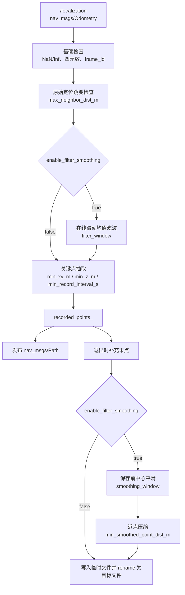
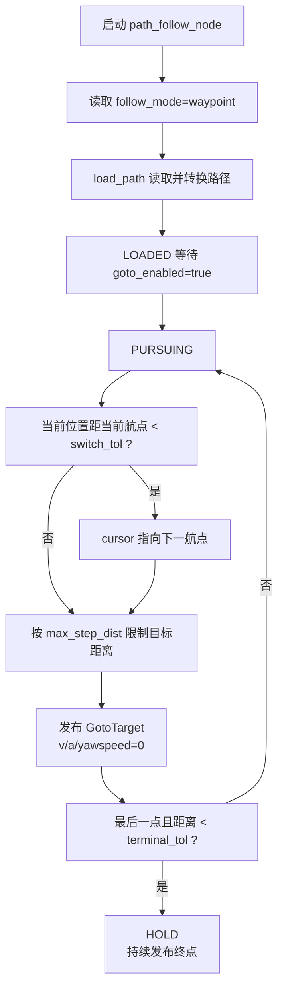
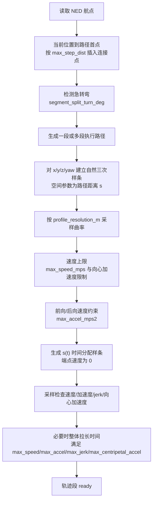
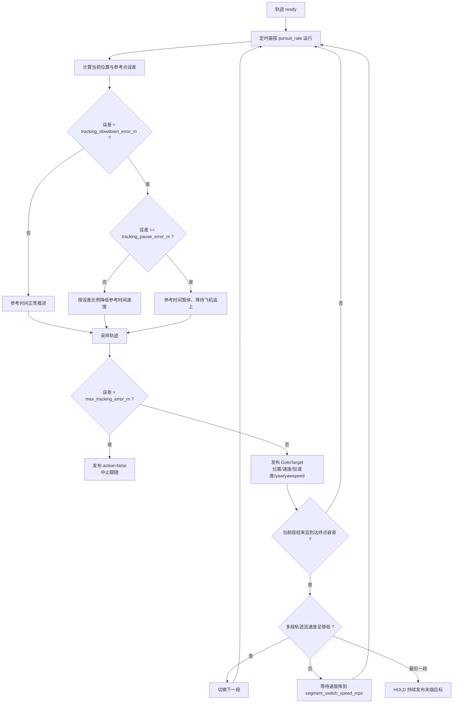

# px4_path 交付使用说明

## 1. 功能定位

`px4_path` 是路径功能包，负责路径录制、路径文件加载、坐标转换、离散航点跟随和连续轨迹跟随。

本包负责：

- 从 FAST-LIO 里程计话题录制路径
- 将路径保存为 TXT 文件
- 在 RViz 中实时发布录制轨迹
- 读取已录制路径文件
- 将 FAST-LIO SLAM 坐标转换为 PX4 NED 坐标
- 根据配置选择两种路径跟随方式：
  - `waypoint`：离散航点逐点跟随
  - `trajectory`：连续样条轨迹跟随，带速度、加速度和航向前馈
- 向 `px4_control` 发布 `/px4_control/goto`
- 监听 `px4_control` 发布的 `/px4_control/goto_enabled`，实现路径跟随启动、暂停和恢复

本包不负责 PX4 Offboard 模式切换、解锁、上锁、降落和最终 PX4 设定值发布。这些由 `px4_control` 完成。

## 2. 节点组成

| 节点 | 可执行文件 | 作用 |
|---|---|---|
| 路径录制节点 | `path_record_node` | 订阅 SLAM 里程计，抽取关键点，平滑/压缩后保存路径文件 |
| 路径跟随节点 | `path_follow_node` | 根据 `follow_mode` 实例化 waypoint 或 trajectory 跟随逻辑 |
| waypoint 跟随逻辑 | `PathFollowWaypointNode` | 逐点发布位置目标，速度/加速度前馈为 0 |
| trajectory 跟随逻辑 | `PathFollowTrajectoryNode` | 构建连续轨迹，发布位置、速度、加速度、yaw、yawspeed |
| 路径加载模块 | `path_loader` | 读取 TXT，校验格式，将 SLAM 坐标转换到 PX4 NED |
| 轨迹生成模块 | `MotionTrajectory` | 构建三维自然三次样条和时间参数化轨迹 |
| 录制处理模块 | `PathRecordProcessor` | 录制输入滤波、保存前平滑、近重复点压缩 |

## 3. 启动方式

`px4_path` 只有一个 launch 入口：

```bash
source install/setup.bash
ros2 launch px4_path px4_path.launch.py
```

启动录制还是跟随，不通过 launch 参数选择，而是在 YAML 中选择：

```yaml
px4_path_launch:
  ros__parameters:
    record_mode: true
```

含义：

| `record_mode` | 启动节点 | 功能 |
|---|---|---|
| `true` | `path_record_node` | 录制路径 |
| `false` | `path_follow_node` | 跟随路径 |

当 `record_mode=false` 时，再通过 `follow_mode` 选择跟随方式：

```yaml
path_follow_node:
  ros__parameters:
    follow_mode: "trajectory"
```

可选值：

| `follow_mode` | 含义 |
|---|---|
| `waypoint` | 离散航点逐点跟随 |
| `trajectory` | 连续轨迹跟随 |

注意：`record_mode` 和 `follow_mode` 都只在节点启动时读取，不支持飞行过程中动态切换。修改 YAML 后需要重新启动 launch。

## 4. 参数文件

统一参数文件：

```text
px4_path/config/params.yaml
```

参数分为三段：

| YAML 段 | 作用 |
|---|---|
| `px4_path_launch.ros__parameters` | 选择启动录制还是跟随 |
| `path_follow_node.ros__parameters` | 路径跟随公共参数、waypoint 参数和 trajectory 参数 |
| `path_record_node.ros__parameters` | 路径录制、保存和滤波平滑参数 |

录制和跟随必须指向同一个路径目录和文件：

```text
path_follow_node.path_dir  == path_record_node.path_dir
path_follow_node.path_file == path_record_node.output_file
```

## 5. 路径录制功能

### 5.1 启动录制

修改 YAML：

```yaml
px4_path_launch:
  ros__parameters:
    record_mode: true
```

启动：

```bash
source install/setup.bash
ros2 launch px4_path px4_path.launch.py
```

节点启动后自动开始录制，不需要额外按键。正常退出节点时，析构函数会自动停止录制并保存路径文件。

### 5.2 录制输入与输出

输入：

| 话题 | 类型 | 默认值 | 说明 |
|---|---|---|---|
| `slam_topic` | `nav_msgs/msg/Odometry` | `/localization` | FAST-LIO 原始里程计 |

输出：

| 话题/文件 | 类型/格式 | 说明 |
|---|---|---|
| `visualization_topic` | `nav_msgs/msg/Path` | RViz 实时显示录制路径，坐标保持 SLAM 原始 frame |
| `path_dir/output_file` | TXT | 路径文件，每行 `x y z qx qy qz qw` |

路径文件保存的是 FAST-LIO SLAM 原始坐标，不在录制阶段转换 ENU/NED。路径跟随加载时，`path_loader` 再统一转换为 PX4 NED。

### 5.3 路径录制流程架构



### 5.4 录制参数说明与调参

| 参数 | 默认值 | 功能 | 调参建议 |
|---|---:|---|---|
| `slam_topic` | `/localization` | FAST-LIO 里程计话题 | 必须与实际定位输出一致，类型必须是 `nav_msgs/msg/Odometry` |
| `expected_frame_id` | `""` | 期望的 SLAM frame。空字符串表示采用第一帧 frame | 多定位源或 frame 可能混乱时建议显式填写 |
| `visualization_topic` | `/path_record/visualization` | RViz 实时路径话题 | RViz 中订阅该话题查看录制结果 |
| `path_dir` | 工程内 `src/path` 目录 | 路径保存目录 | 必须与跟随节点 `path_dir` 一致；换机器后要改成本机路径 |
| `output_file` | `recorded_path.txt` | 输出文件名 | 只写文件名，不要带目录 |
| `overwrite_existing` | `false` | 是否覆盖同名文件 | `true` 方便反复录同一条；`false` 会生成 `_1/_2` 等版本 |
| `enable_filter_smoothing` | `true` | 是否启用录制处理链路 | 定位抖动明显时用 `true`；希望保留原始关键点时用 `false` |
| `min_xy_m` | `0.12` | 水平方向关键点距离阈值，单位 m | 变小会记录更密，路径更贴近原始轨迹；变大会减少点数 |
| `min_z_m` | `0.10` | 竖直方向关键点距离阈值，单位 m | 高度变化细节多时调小；高度噪声大时调大 |
| `max_neighbor_dist_m` | `5.0` | 原始定位和最终航点的最大相邻距离 | 太小会误判正常快速移动；太大会放过定位跳变 |
| `min_record_interval_s` | `0.05` | 关键点最短时间间隔，单位 s | 调大可减少高频抖动点；设 `0` 关闭时间限频 |
| `filter_window` | `5` | 在线输入滑动平均窗口 | 只在 `enable_filter_smoothing=true` 生效；大一些更抗抖，但位置滞后更明显 |
| `smoothing_window` | `3` | 保存前中心滑动平均窗口 | 建议奇数；大一些更平滑，但急弯会被削弱 |
| `min_smoothed_point_dist_m` | `0.05` | 平滑后近点压缩距离 | 增大可减少点数；设 `0` 关闭压缩 |
| `min_points` | `2` | 允许保存的最少有效点数 | 必须不小于 2 |

## 6. 路径文件加载与坐标转换

路径文件每行格式：

```text
x y z qx qy qz qw
```

加载时会执行：

```text
FAST-LIO SLAM 坐标
  -> SLAM 到 ENU：x_enu=-x_slam, y_enu=-y_slam, z_enu=z_slam
  -> ENU 到 PX4 NED：x_ned=y_enu, y_ned=x_enu, z_ned=-z_enu
```

yaw 也会按同样坐标关系转换到 PX4 NED 航向：

```text
yaw_slam -> yaw_enu = yaw_slam + pi -> yaw_ned = pi/2 - yaw_enu
```

加载检查：

- 空行和 `#` 注释行会跳过。
- 每个有效数据行必须刚好 7 个浮点数。
- 四元数会归一化；偏离范围时输出 warning。
- 相邻点三维距离超过 `max_neighbor_dist_m` 时拒绝整条路径。
- 点数少于 `min_points` 时拒绝加载。

## 7. 路径跟随公共流程

### 7.1 启动跟随

修改 YAML：

```yaml
px4_path_launch:
  ros__parameters:
    record_mode: false

path_follow_node:
  ros__parameters:
    follow_mode: "trajectory"
```

启动：

```bash
source install/setup.bash
ros2 launch px4_path px4_path.launch.py
```

同时还需要启动 `px4_control`：

```bash
# 终端 1
source install/setup.bash
ros2 launch px4_control px4_control.launch.py

# 终端 2
source install/setup.bash
ros2 launch px4_control px4_teleop.launch.py
```

### 7.2 跟随操作顺序

```text
1. 启动 px4_control_node
2. 启动 px4_teleop_node
3. 启动 px4_path，record_mode=false
4. 按 0 请求 Offboard
5. 按 1 解锁起飞
6. 等待 px4_control 进入 HOVER
7. 按 4 打开外部 Goto 许可
8. px4_path 收到 /px4_control/goto_enabled=true 后开始发布 /px4_control/goto
9. 按 5 可暂停路径跟随并保持当前位置
10. 再按 4 可从暂停处恢复
```

### 7.3 跟随节点公共接口

订阅：

| 话题 | 类型 | 用途 |
|---|---|---|
| `/fmu/out/vehicle_local_position` | `px4_msgs/msg/VehicleLocalPosition` | 获取当前 NED 位置、速度、航向和有效状态 |
| `/px4_control/goto_enabled` | `std_msgs/msg/Bool` | 接收控制节点发出的外部 Goto 许可 |

发布：

| 话题 | 类型 | 用途 |
|---|---|---|
| `/px4_control/goto` | `px4_control/msg/GotoTarget` | 向控制节点发送路径目标 |

### 7.4 跟随公共状态

```text
INIT
  节点刚启动，等待路径和定位
LOADED
  路径已加载，定位有效，等待 goto_enabled=true
PURSUING
  正在发布 GotoTarget
PAUSED
  goto_enabled=false，冻结当前进度
HOLD
  到达终点，持续发布终点保持目标
```

`/px4_control/goto_enabled=false` 时，跟随节点进入 `PAUSED`，停止推进游标或轨迹时间。再次变为 `true` 时，从保存的游标或轨迹时间继续。

## 8. 跟随公共参数

| 参数 | 默认值 | 功能 | 调参建议 |
|---|---:|---|---|
| `follow_mode` | `trajectory` | 选择 `waypoint` 或 `trajectory` | 需要简单稳定逐点跟随用 `waypoint`；需要平滑速度/加速度前馈用 `trajectory` |
| `path_dir` | 工程内 `src/path` 目录 | 路径读取目录 | 必须与录制节点 `path_dir` 一致 |
| `path_file` | `recorded_path.txt` | 路径文件名 | 如果录制时 `overwrite_existing=false` 生成了 `_1` 文件，这里要改成实际文件名 |
| `pursuit_rate` | `20.0` | 发布 `GotoTarget` 的频率，单位 Hz | 应小于等于系统可稳定处理频率；一般 `10~50` |
| `terminal_tol` | `0.20` | 距终点小于该值后进入 HOLD，单位 m | 太小可能难以结束；太大可能提前结束 |
| `max_step_dist` | `1.5` | 最大连接/单步距离，单位 m | 路径起点离飞机当前位置较远时，用它限制连接段或 waypoint 单次目标 |
| `max_neighbor_dist_m` | `5.0` | 路径加载时相邻点最大允许距离，单位 m | 应与录制节点一致，用于过滤异常跳点 |

## 9. waypoint 跟随功能

### 9.1 组成

waypoint 跟随由以下部分组成：

- `path_follow.cpp`：读取 `follow_mode=waypoint`，创建 `PathFollowWaypointNode`
- `path_loader.cpp`：读取路径文件并转换为 PX4 NED 航点
- `PathFollowWaypointNode`：维护游标 `cursor_`，按距离阈值逐点推进
- `/px4_control/goto`：发送当前位置目标给控制节点

### 9.2 实现流程



### 9.3 waypoint 专用参数

| 参数 | 默认值 | 功能 | 调参建议 |
|---|---:|---|---|
| `switch_tol` | `0.10` | 距当前航点小于该三维距离时切换下一点，单位 m | 点很密时调小；定位噪声大或速度较快时调大 |

公共参数中的 `max_step_dist` 在 waypoint 模式下表示：如果当前航点距离飞机当前位置太远，则不直接发送远处航点，而是沿当前位置到目标航点方向截取一个距离不超过 `max_step_dist` 的临时目标。

## 10. trajectory 跟随功能

### 10.1 组成

trajectory 跟随由以下部分组成：

- `path_follow.cpp`：读取 `follow_mode=trajectory`，创建 `PathFollowTrajectoryNode`
- `path_loader.cpp`：读取路径文件并转换为 PX4 NED 航点
- `find_path_turn_splits`：检测急转弯，必要时把整条路径拆成多段
- `PathFollowTrajectoryNode::make_execution_segments`：从飞机当前位置生成连接段，并按急弯拆分执行段
- `MotionTrajectory`：对每段生成自然三次样条和时间参数化轨迹
- `PathFollowTrajectoryNode::on_timer`：按轨迹时间采样，并根据跟踪误差进行减速、暂停或中止
- `/px4_control/goto`：发布位置、速度、加速度、yaw、yawspeed 前馈

### 10.2 轨迹生成流程



### 10.3 运行时跟随流程



### 10.4 trajectory 参数说明与调参

| 参数 | 默认值 | 功能 | 调参建议 |
|---|---:|---|---|
| `max_speed_mps` | `0.8` | 连续轨迹最大三维速度，单位 m/s | 降低可让轨迹更慢更稳；提高会缩短执行时间 |
| `max_accel_mps2` | `1.0` | 最大三维加速度，单位 m/s² | 降低会让启停和弯道更柔和；过低会显著拉长轨迹 |
| `max_jerk_mps3` | `2.5` | 最大三维 jerk，单位 m/s³ | 不直接发布给 PX4，只用于采样校验和整体时间拉伸 |
| `max_centripetal_accel_mps2` | `0.35` | 最大向心加速度，单位 m/s² | 越小，弯道自动降速越明显 |
| `profile_resolution_m` | `0.15` | 曲率和速度曲线空间采样间隔，单位 m | 小一些更容易捕捉短急弯，但轨迹构建计算量更大 |
| `segment_split_turn_deg` | `140.0` | 达到该转角时拆成停到停分段，单位 deg | 接近折返的路线建议开启；设 `0` 关闭自动拆段 |
| `segment_switch_speed_mps` | `0.20` | 分段切换要求的最大实际速度，单位 m/s | 降低可让急弯处分段切换更稳；提高可减少等待 |
| `tracking_slowdown_error_m` | `1.00` | 跟踪误差超过该值开始降低参考时钟速度，单位 m | 小一些更早减速；大一些更接近原始时间执行 |
| `tracking_pause_error_m` | `1.50` | 跟踪误差达到该值时暂停参考时钟，单位 m | 必须大于 `tracking_slowdown_error_m` |
| `max_time_scale_rate_per_s` | `1.2` | 参考时钟缩放比例每秒最大变化量 | 小一些可避免速度/加速度前馈突变；太小恢复会慢 |
| `max_tracking_error_m` | `5.0` | 最大允许跟踪误差，超过后中止，单位 m | 设为 `<=0` 可关闭该中止保护 |
| `yaw_mode` | `fixed` | 航向模式：`fixed`、`recorded`、`tangent` | 定点朝向用 `fixed`；复现录制朝向用 `recorded`；沿路径朝向用 `tangent` |
| `yaw_lookahead_s` | `0.5` | `tangent` 模式航向前视时间，单位 s | 增大可提前转向；过大可能在急弯处提前过多 |
| `max_yaw_rate_rps` | `0.5` | 发布 yaw 最大变化速率，单位 rad/s | 降低航向变化更柔和；提高转向更快 |

## 11. 常用命令示例

录制路径：

```bash
# 修改 params.yaml: record_mode=true
source install/setup.bash
ros2 launch px4_path px4_path.launch.py
```

查看录制轨迹：

```bash
ros2 topic echo /path_record/visualization
```

跟随路径：

```bash
# 修改 params.yaml: record_mode=false, follow_mode="trajectory" 或 "waypoint"
source install/setup.bash
ros2 launch px4_path px4_path.launch.py
```

